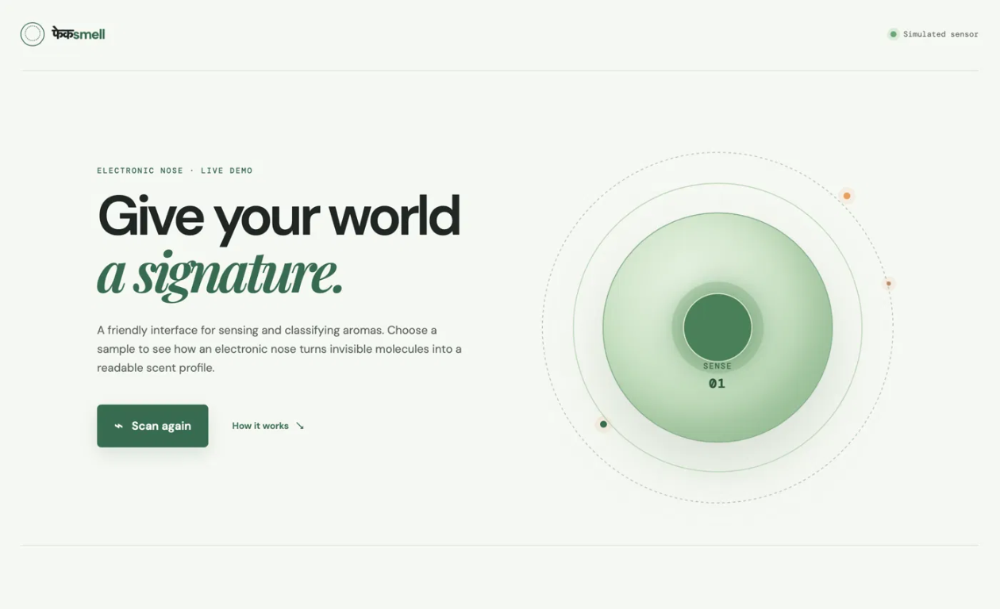
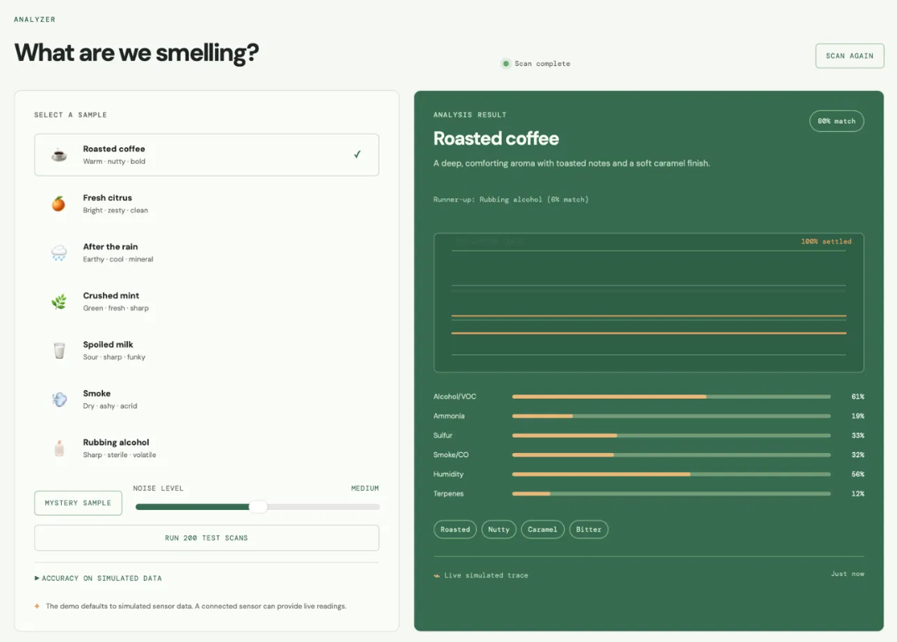

# फेकsmell

> **Smell, translated.**

**Problem:** Important changes in smell can be difficult to notice, describe, or investigate early.

**Who it helps:** Kitchens and supply chains, homes and hostels, classrooms and workplaces, and people with anosmia.

फेकsmell is a hackathon-ready electronic-nose experience for a practical problem: smell can carry early clues about spoiled food, smoke, indoor air, and scent description for people with anosmia. It turns invisible scent signals into a visual, understandable profile. The current prototype runs entirely in the browser with a deterministic sensor simulation, so it is reliable to demo without special hardware and makes no medical or safety-certification claims.

## Why it matters

People understand smells intuitively, but machines usually expose them as raw voltage readings or sensor charts. फेकsmell creates a friendly translation layer:

1. **Capture** a scent signal from an electronic-nose sensor array.
2. **Compare** it with known scent fingerprints.
3. **Describe** the result using a name, confidence score, and sensory notes.

For the hackathon demo, the first step is simulated so the experience works on any laptop. The UI and data model are ready for a real sensor adapter later.

## Live demo

Try the deployed prototype at <https://rudragarg-ds.github.io/fakekhushbu/>.

## Screenshots

These placeholders can be replaced with current captures of the home and result states:





## Demo features

- One-click scan animation with clear sensor status feedback.
- Live canvas trace that settles toward all six simulated sensor readings.
- Seven sample profiles, including spoiled milk, smoke, and rubbing alcohol.
- Uncertainty handling that shows the top three candidates when the signal is ambiguous.
- Mystery samples that reveal whether the predicted class matches the hidden source.
- A low/medium/high noise control and a 200-scan confusion-matrix benchmark labelled as simulated data.
- Optional Web Serial input for six-channel Arduino/ESP32 CSV readings at 9600 baud.
- Six-channel simulated readings with seeded Gaussian noise and cosine-similarity softmax classification.
- Recent scan history stored in `localStorage`.
- Responsive layout for laptops, tablets, and phones.
- Accessible buttons, labels, live result updates, and reduced visual complexity on small screens.
- No framework, build step, database, or API key required.

## Run locally

### Option 1: open the file

Open [`index.html`](./index.html) directly in a modern browser.

### Option 2: use a local server

From this directory:

```bash
python3 -m http.server 8000
```

Open <http://localhost:8000>.

Using a local server is recommended when testing browser integrations or deploying from a development environment.

## 60-second demo script

1. **0–10s:** Introduce the problem: smell can carry clues about spoilage, smoke, indoor air, and accessibility.
2. **10–25s:** Choose **Fresh citrus**, click **Start a scan**, and point out the six-channel trace, confidence, and scent notes.
3. **25–40s:** Click **Mystery sample** and reveal the hidden actual class with the correct/wrong badge.
4. **40–52s:** Move **Noise level** to High and run **Run 200 test scans** to show the simulated accuracy and confusion matrix.
5. **52–60s:** Explain that the next step is a real ESP32 sensor array and labelled calibration data, not a certified safety or medical device.

## Project structure

```text
index.html   Semantic page structure and demo content
style.css    Visual system, responsive layout, and animations
script.js    Sample data, scan state machine, and local history
README.md    Product story, setup, demo flow, and integration notes
```

## Sensor integration path

Browsers cannot smell without an external sensor. A production version would replace the sample selection in `script.js` with an adapter that:

1. Reads a normalized array of sensor values from an Arduino, ESP32, or backend API.
2. Maps those values to the same six-channel profile shape used by the demo.
3. Sends the profile through the existing result-rendering flow.
4. Keeps confidence scores and uncertainty thresholds calibrated against a labelled training set.

Possible next steps are Web Serial for a USB-connected microcontroller, Web Bluetooth for a supported device, or a small server endpoint for model inference. The current UI intentionally keeps this boundary clean so a hardware integration does not require a redesign.

### Optional Web Serial sensor

On a Chromium-based browser with Web Serial support, the **Connect sensor** button appears when the page is served over a secure context. Choose a USB serial device that sends six newline-delimited CSV values at 9600 baud, for example:

```text
412,88,31,16,520,740
```

Values in the `0..1023` analog range are normalized to `0..1` before entering the existing classifier. The example sender is [`docs/esp32_sketch.ino`](./docs/esp32_sketch.ino). If the port disconnects or returns an error, the app returns to the simulated sensor.

## How the classifier works

1. **6-channel simulated array:** Each reading contains normalized Alcohol/VOC, Ammonia, Sulfur, Smoke/CO, Humidity, and Terpenes values. `simulateReading()` adds seeded Gaussian noise and a small baseline drift.
2. **Fingerprint comparison:** `classify()` compares the simulated vector with every reference fingerprint using cosine similarity.
3. **Softmax confidence:** Similarities become probabilities through a temperature-scaled softmax.
4. **Uncertainty threshold:** If the top probability is below 55% or its lead is below 12 percentage points, the UI says **Not sure** and shows the top three candidates.

### Measured accuracy (simulated)

The **Run 200 test scans** button measures accuracy against the app's own simulated fingerprints at the selected noise level. The result and confusion matrix are a benchmark of simulated data only, not real-world sensor accuracy.

## Important limitation

This repository is a working **front-end prototype**, not a chemical measurement device. Its simulated readings demonstrate the product experience and interaction design; they should not be presented as real-world odour identification or safety advice.

## License

MIT. See [`LICENSE`](./LICENSE).
